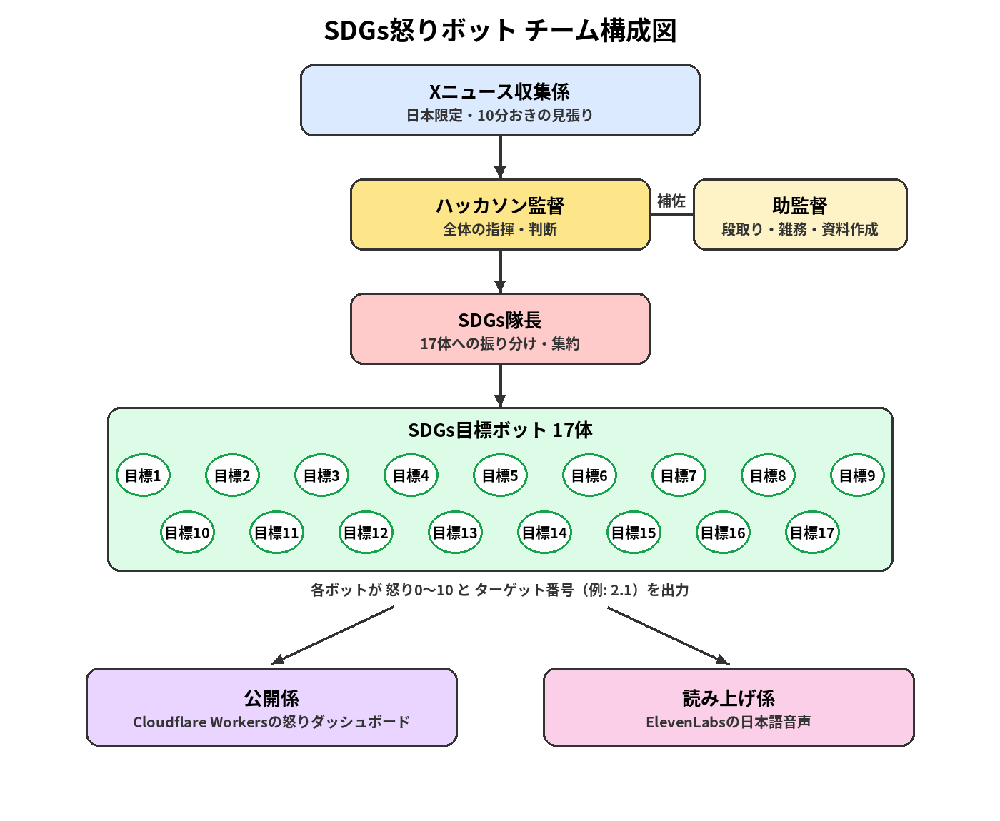

# SDGs怒りボット

ニュースを読んで、SDGs17目標の観点で怒るボットチームです。Xのニュースを見張り、届いたニュースを17体のSDGs目標ボットに配って、それぞれが担当ターゲットの立場から怒りを表明します。怒りはダッシュボードに通知バッジと震えるタイルで表示され、いちばん怒った目標の演説は日本語音声で読み上げられます。Grok Bot Tokyo Hackathon（2026-10-11）の作品です。

## 公開ダッシュボード

https://sdgs-anger-dashboard.taira-sakakibara.workers.dev/

## チーム構成

```
Xニュースの見張り（日本のニュース限定・10分おき）
  → ハッカソン監督・助監督
    → SDGs隊長
      → SDGs目標ボット17体
        → 公開係（Cloudflare Workers）／ 読み上げ係（ElevenLabs v4・日本語声 Ryusei）
```



## 今日の目標

- 16:00までに、デモ動画・スライド・公開URLを提出する
- 怒りで終わらず行動へ（#OnigiriAction で締める）

## メンバー

- ぺいくん：本体（ボット・パイプライン・ダッシュボード）
- エミリアさん：見せ方（スライド・デモの流れ）

## フォルダ

- `index.html` / `anger.json` / `anger.sample.json`：怒りダッシュボード
- `docs/anger-format.md`：anger.json の形式
- `audio/`：読み上げ音声
- `screenshots/`：ダッシュボードのスクリーンショット
- `submit/`：構成図・デモ台本・提出チェックリスト

進捗は [PROGRESS.md](PROGRESS.md) を見てください。
